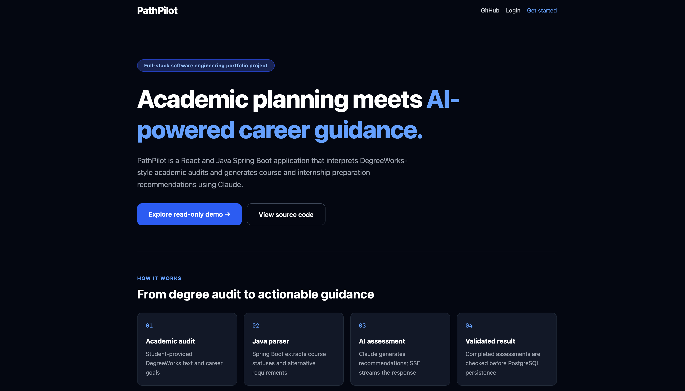
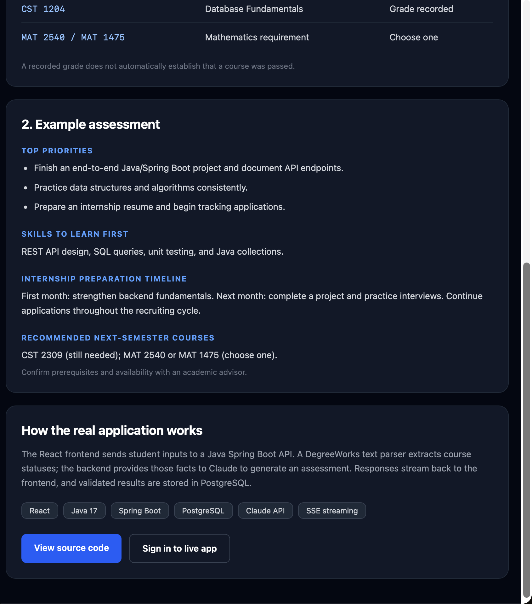
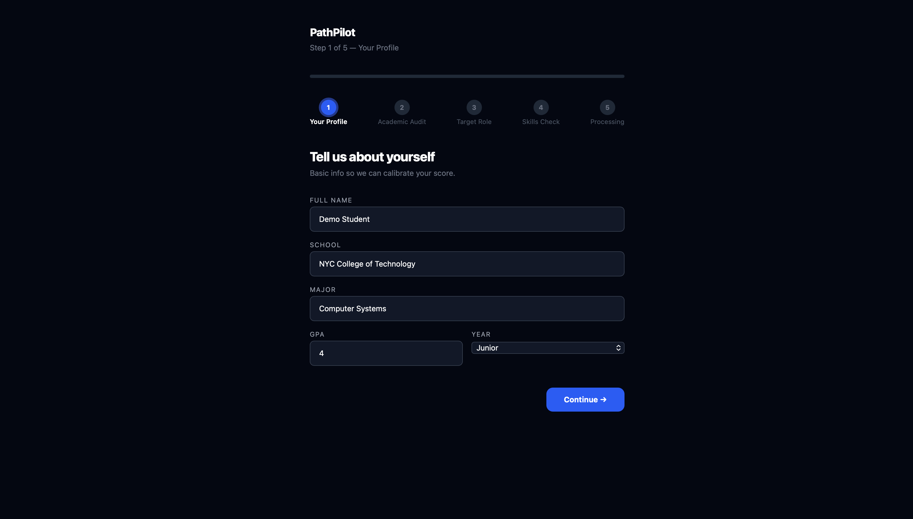
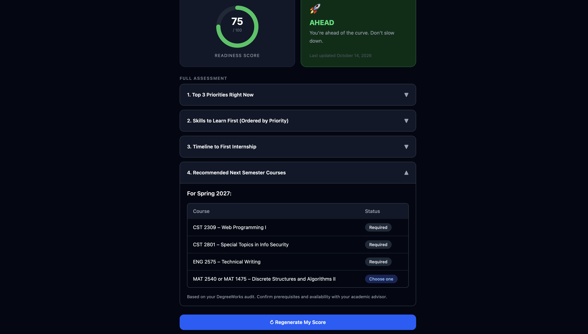
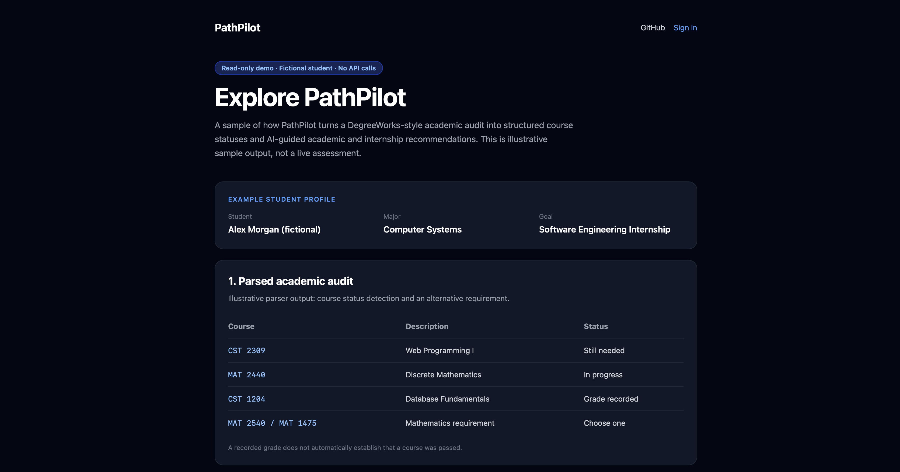
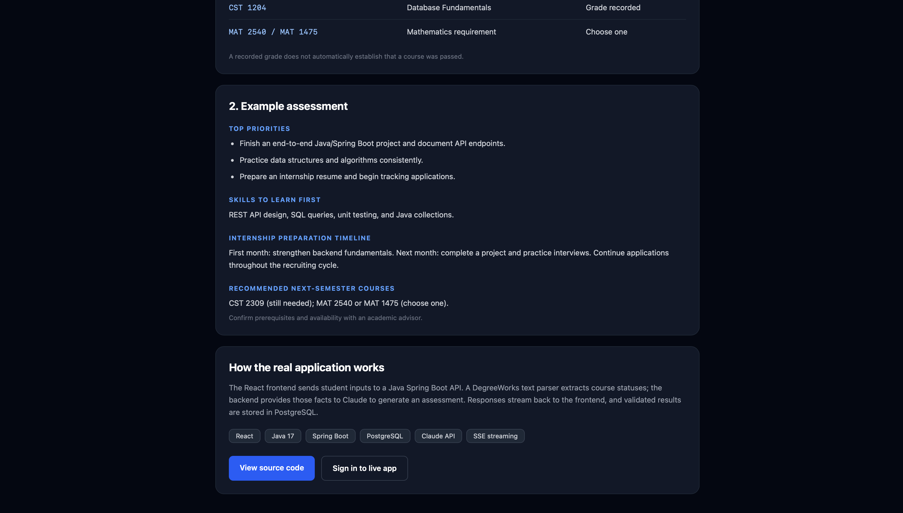

# PathPilot

**AI-assisted academic planning and software engineering career guidance.**

PathPilot is a full-stack portfolio project that turns a student's DegreeWorks audit, academic profile, skills, and career goals into an actionable assessment. It combines deterministic academic-text parsing with Claude-generated recommendations.

**[Live application](https://path-pilot-rho.vercel.app)** · **[Public read-only demo](https://path-pilot-rho.vercel.app/demo)**

> Built as a software engineering portfolio project, not a commercial advising platform. AI recommendations are guidance, not official academic or hiring decisions.

## Try it

- **Read-only demo:** Open [the sample assessment](https://path-pilot-rho.vercel.app/demo). No account or API request required.
- **Authenticated demo:** Visit [login](https://path-pilot-rho.vercel.app/login) and use the shared recruiter account displayed on the landing page. Use fictional data only. AI generations for this account have a basic five-attempt daily limit.

## What it does

1. Students create an account and enter their academic and career profile.
2. They paste a DegreeWorks audit and describe their current skills and target role.
3. The Spring Boot backend parses course status information and builds a structured prompt.
4. Claude streams a career assessment to the React interface, including priorities, skill gaps, a timeline, and possible next-semester courses.
5. Completed, validated assessments are saved in PostgreSQL and available in plan history.

The assessment includes a **Behind / On Track / Ahead** status and a deterministic profile-based score. These are application-generated indicators, **not validated measures of internship readiness**.

## Engineering highlights

- **Java 17 / Spring Boot REST backend:** Controllers, services, Spring Data JPA, and PostgreSQL persistence.
- **JWT authentication:** Spring Security protects student workflows and assessment history.
- **DegreeWorks parsing:** Extracts course status information before AI generation. Distinguishes in-progress, still-needed, grade-recorded, and alternative requirements instead of treating every course mention as required.
- **Streaming AI responses:** Spring WebClient consumes Anthropic's streaming API; server-sent events deliver output to the frontend as it arrives.
- **Reliability checks:** AI requests have a timeout; incomplete or invalid assessments are not saved.
- **Demo safeguards:** Generation requests verify profile ownership. The shared demo account has a simple per-process five-attempt daily limit; it resets at midnight UTC or on application restart and is **not** a distributed rate limiter.
- **Testing:** JUnit tests cover assessment validation/save policy and demo-generation limits.

## Architecture

```text
React + Vite frontend (Vercel)
       |
       | REST / JWT / streamed assessment output
       v
Spring Boot API (Railway)
       |                    |
       | JPA                | WebClient
       v                    v
PostgreSQL (Railway)     Anthropic Claude API
```

**Backend flow:** Authenticate request → load the student's profile → parse DegreeWorks course statuses → construct the prompt → stream Claude's response → validate completed output → save assessment history.

## Technology

| Area | Stack |
| --- | --- |
| Frontend | React, Vite, Tailwind CSS, React Router |
| Backend | Java 17, Spring Boot, Spring Security, Spring Data JPA |
| Database | PostgreSQL |
| AI integration | Anthropic Claude API, WebClient, SSE |
| Authentication | JWT |
| Tests | JUnit / Spring Boot Test |
| Deployment | Vercel (frontend), Railway (backend/database) |

## Screenshots

### Landing page



### Student dashboard


### AI-generated assessment


### Public recruiter demo



## Run locally

**Requirements:** Java 17, Node.js/npm, PostgreSQL, and an Anthropic API key for live AI generation.

```bash
# Backend (repository root)
./mvnw spring-boot:run
```

Configure the backend's database connection, JWT secret, and Anthropic API key through your local configuration or environment. **Never commit real secrets.** A local PostgreSQL database must be available for persistence.

In a separate terminal:

```bash
cd pathpilot-vite
npm install
npm run dev
```

The deployed frontend currently calls the hosted API; to use a local backend, update the frontend's API base URLs accordingly.

### Tests and build

```bash
# From repository root
./mvnw clean test

# From pathpilot-vite/
npm run build
```

## Limitations and tradeoffs

- DegreeWorks formats vary by institution; the parser may not interpret every audit correctly.
- AI output can be inaccurate. Course availability, prerequisites, and graduation requirements must be confirmed with an academic advisor.
- The current frontend uses hosted API URLs rather than a fully configurable API base URL.
- The shared demo's generation limit is in memory, not persistent across restarts or multiple server instances.
- This is a recruiter-facing portfolio application, not a production academic advising service.

## Why I built it

As a transfer student, I wanted a clearer way to connect academic progress with the practical skills and preparation needed for software engineering internships. PathPilot became an opportunity to build that workflow end-to-end while practicing backend development, authentication, database design, external API integration, and reliability testing.

**Built by Cyril** · Computer Systems Technology, NYC College of Technology
